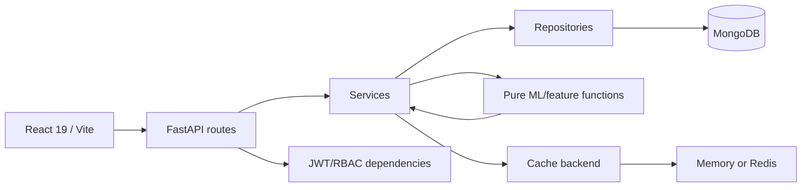

# P.A.T.H. — Public Anomaly Tracking Hub

P.A.T.H. is a research-grade anomaly-screening platform for public-fund disbursals. It sits **above** authoritative public financial management systems such as PFMS; it does not replace them and does not make legal, disciplinary, accounting, or fraud findings.

> **Core principle: Unusual != Fraudulent.** A model score is a screening signal for authorized human review.

## Prerequisites

- Python **3.14.x**
- Node.js **24.x** and npm bundled with Node
- MongoDB **8.2.x**
- Docker Engine 27+ and Docker Compose v2 (recommended)

## Docker quick start

Supported series: Python **3.14.x**, Node **24.x**, MongoDB **8.2.x** and Docker
Engine 27+ / Compose v2.24+. Dockerfiles pin exact image digests; Python locks pin
all artifacts with hashes. The local permission smoke also ran against MongoDB
8.3.2; the container and TLS checks must still pass on the deployment target.

On Windows generate private configuration with:

```powershell
powershell -NoProfile -ExecutionPolicy Bypass -File .\setup-dev.ps1 -Docker
```

Otherwise copy `infra/mongo.env.example` to `infra/mongo.env` and `backend/.env.example`
to `backend/.env`. Generate unique random secrets and match the app password in the
backend URI to `PATH_APP_PASSWORD`; use host `mongo` and `HOST=0.0.0.0` in Docker.
Only Mongo receives its root credentials. Then:

```bash
docker compose up --build -d
docker compose exec backend python scripts/create_user.py --email you@example.com --role admin
```

Choose a password of 12-128 characters at the private prompt. Open
<http://localhost:5173>. No default user is shipped. Never distribute environment
files or data directories. Read [secret rotation](docs/SECRET_ROTATION.md) before
reusing a shared archive. Existing volumes need a privileged role migration; merely
changing initialization environment variables does not change database users.

## Manual quick start

On Windows run `setup-dev.ps1` without `-Docker`, then:

```powershell
cd backend
python -m venv .venv
.\.venv\Scripts\python.exe -m pip install --require-hashes -r requirements-dev.lock
cd ..\frontend
npm ci
cd ..
.\start_path.bat
```

The launcher needs `mongod` on PATH, starts an authenticated loopback database and
checks readiness. From `backend/`, create the first admin using the command above
with `.venv\Scripts\python.exe` instead of `docker compose exec backend python`.
For Linux/macOS use `.venv/bin/python`, start Mongo with authentication and provision
the custom role with `scripts/provision_mongo.py` as a DB administrator. Start the
API with `python -m app.run` from `backend/`, then `npm run dev` from `frontend/`.
Vite proxies `/api` and `/health` to port 8000. Use only one startup method at a time.

## Environment matrix

| Variable | File | Consumed by | Required | Description |
|---|---|---|---|---|
| MONGO_ROOT_USER / MONGO_ROOT_PASSWORD | infra/mongo.env | Mongo only | yes | Bootstrap admin; never passed to backend |
| PATH_APP_USER / PATH_APP_PASSWORD | infra/mongo.env | Mongo only | yes | Custom application-role identity |
| MONGO_URI | backend/.env | Backend | yes | Authenticated least-privilege app URI; URL-encode passwords |
| JWT_SECRET | backend/.env | Backend | yes | At least 32 random bytes; rotate exposed keys |
| MONGO_DB / ENVIRONMENT / DOCS_ENABLED | backend/.env | Backend | no | Database and environment; production docs disabled |
| HOST / WORKERS | backend/.env | Uvicorn | no | Default 127.0.0.1 / 1; Docker binds all interfaces privately |
| FORWARDED_ALLOW_IPS | backend/.env | Uvicorn | proxy | Exact trusted proxy addresses; never * on a public edge |
| CORS_ORIGINS / CORS_METHODS / CORS_HEADERS | backend/.env | Backend | no | Explicit browser allowlists |
| JWT_ALGORITHM / ACCESS_TOKEN_MINUTES / REFRESH_TOKEN_DAYS | backend/.env | Backend | no | Signing algorithm and session limits |
| MAX_UPLOAD_MB / MAX_ROWS | backend/.env | Backend | no | Defaults 25 MB / 100000 rows |
| ML_MAX_ROWS / ML_N_JOBS / ML_UMAP_MAX_ROWS | backend/.env | Backend | no | Bounded model memory, CPU and sample size |
| MODEL_LOCK_SECONDS | backend/.env | Backend | no | Renewable lease duration, default 300 seconds |
| DATA_RETENTION_DAYS / AUDIT_RETENTION_DAYS | backend/.env | Backend / TTL | no | Defaults 365 days |
| CACHE_BACKEND / CACHE_TTL_SECONDS | backend/.env | Backend | no | Redis required for multiple workers |
| REDIS_PASSWORD | infra/redis.env | Redis only | production | Unique cache credential |
| REDIS_URL | backend/.env | Backend | Redis | Authenticated URI matching Redis password |
| MONGO_TLS_CA_FILE / MONGO_TLS_CERT_KEY_FILE | backend/.env | Backend | production | Internal CA and client identity |
| VITE_API_URL | frontend/.env | Browser build | no | Public origin only; never put secrets here |
| DOMAIN | .env | Caddy | production | Public hostname; no database credentials |

Production additionally requires `infra/redis.env` and TLS certificates. See
[deployment security](docs/DEPLOYMENT_SECURITY.md). Refresh-token replay revokes
sessions; role and active-state changes revoke sessions; password resets require
an authenticated password change at next login.

## Roles

- `analyst`: read transactions/anomalies/analytics; run models.
- `reviewer`: analyst capabilities plus review decisions.
- `admin`: reviewer capabilities plus dataset mutation, users, and audit logs.

### Separation of duties

If a reviewer records `Confirmed Finding` or `Escalated`, that same reviewer cannot change that case to a different status next. A different reviewer or an admin must record the next action. This rule is enforced in `backend/app/services/review_service.py`.

## Dataset

The bundled research CSV contains **4,000 synthetic rows** generated by `backend/scripts/generate_dataset.py`. It is for reproducible development/testing only and must never be represented as real government transactions.

Money is normalized to integer paise; transaction dates are stored as BSON dates. Uploads are versioned: a validated new version is inserted before the active dataset pointer is changed.

## Background-job choice

The MVP uses FastAPI `BackgroundTasks` because it keeps the deployment lightweight while the Mongo `locks` collection enforces one model run globally. Results are written under a new immutable `run_id` and only then is the active-run pointer switched. For sustained multi-instance/high-throughput workloads, replace the execution adapter with RQ/Arq/Celery while keeping the service/repository contracts; Redis is already supported for shared caching.

## Model semantics

- `if`: standard scikit-learn Isolation Forest baseline.
- `eif`: **EIF-lite research approximation** using deterministic random hyperplane projections before Isolation Forest; not a verbatim implementation of Hariri et al.
- `dif`: **DIF-lite research approximation** using deterministic randomized ReLU representations before Isolation Forest; not a verbatim implementation of Xu et al.

Risk labels are population-percentile labels, not fixed fraud thresholds: top 1% Critical, next 4% High, next 10% Medium, next 20% Low, remainder Normal. The alert budget is a separate Top-K operational cap.

## Architecture



## Directory map

```text
backend/app/routes        HTTP only
backend/app/services      business rules
backend/app/repositories  Mongo access
backend/app/schemas       Pydantic contracts/enums
backend/app/ml            pure feature/model functions
backend/app/core          config/security/cache/logging
frontend/src/services/api authenticated API client
frontend/src/hooks        abort-safe data hooks
frontend/src/components   reusable UI primitives
frontend/src/pages        9 product views
infra                     Mongo/Caddy deployment config
docs                      API, privacy, model and deployment docs
```

## Quality commands

```bash
make lint
make test
make audit
make build
make e2e
```

Backend directly:

```bash
cd backend
ruff check .
ruff format --check .
mypy app
pytest
pip-audit -r requirements.lock
```

Frontend:

```bash
cd frontend
npm ci
npm run lint
npm run format:check
npm test
npm run build
npm audit --audit-level=high
ANALYZE=true npm run build
```

The visualizer writes `frontend/dist/stats.html`.

## Troubleshooting

- **Startup fails immediately:** required `MONGO_URI` or `JWT_SECRET` is missing/invalid. This is intentional fail-fast behavior.
- **401:** access token missing/expired and refresh cookie unavailable/revoked.
- **403:** authenticated role lacks the requested capability.
- **409 on model run:** another run holds the global Mongo lock.
- **409 on dataset upload:** an active dataset exists; admin must explicitly send `confirm_replace=true`.
- **429 on login:** five failed attempts occurred inside the 15-minute email+IP window.
- **Mongo ready check fails:** verify URI, credentials, TLS paths, and server reachability.

## Production TLS and Mongo encryption

See `docs/DEPLOYMENT_SECURITY.md`. `docker-compose.prod.yml` puts Caddy at the public edge, requires Mongo TLS inside the private network, and configures Redis for multi-worker cache coherence.

## API

- `docs/API.md`
- `docs/openapi.json` generated by `python backend/scripts/export_openapi.py`
- `docs/PATH.postman_collection.json`

## License

MIT. See `LICENSE` and `THIRD_PARTY_LICENSES.md`.
