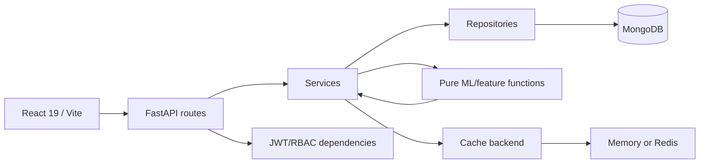

# P.A.T.H. — Public Anomaly Tracking Hub

P.A.T.H. is a research-grade anomaly-screening platform for public-fund disbursals. It sits **above** authoritative public financial management systems such as PFMS; it does not replace them and does not make legal, disciplinary, accounting, or fraud findings.

> **Core principle: Unusual != Fraudulent.** A model score is a screening signal for authorized human review.

## Prerequisites

- Python **3.14.x**
- Node.js **24.x** and npm bundled with Node
- MongoDB **8.2.x**
- Docker Engine 27+ and Docker Compose v2 (recommended)

## Docker quick start

### Windows (PowerShell)

Open Docker Desktop and wait for the engine to start. In PowerShell, run:

```powershell
cd C:\Users\shaba\Desktop\PATH
powershell -NoProfile -ExecutionPolicy Bypass -File .\setup-dev.ps1
docker compose up --build -d
docker compose exec backend python scripts/create_user.py --email you@example.com --role admin
```

Use your own email and choose a password of at least 12 characters when prompted.
Open <http://localhost:5173>. The setup script creates both environment files with
matching, randomly generated local credentials and stops if either file already
exists. It is intended for a fresh local database. Keep `.env` files private.
With Docker, you do not need to install Python or Node dependencies on Windows.

To view startup errors: `docker compose logs --tail=100 backend frontend mongo`.
To stop the project without deleting data: `docker compose stop`.

### Other platforms / manual configuration

1. Copy `.env.example` to `.env` manually.
2. Replace every example credential with a unique secret. Generate the JWT secret with `openssl rand -hex 32`.
3. Run:

```bash
docker compose up --build
```

4. Create the first admin from the backend container:

```bash
docker compose exec backend python scripts/create_user.py --email you@example.com --role admin
```

5. Open `http://localhost:5173`.

No default account is shipped with the project.

## Manual quick start

On Windows with dependencies installed and the environment files configured,
double-click `start_path.bat` or run `powershell -NoProfile -ExecutionPolicy Bypass -File .\start-local.ps1`.
This starts the installed `mongod`, backend and frontend locally without Docker,
keeps MongoDB authentication enabled, and checks backend database readiness.
MongoDB data and process logs are kept in the ignored `.local/` folder.
The dedicated local database is separate from Docker's database volume; use one
startup method at a time. Create your first application account using the command below.

### Backend

```bash
cd backend
python -m venv .venv
# Windows: .venv\Scripts\activate
# Linux/macOS: source .venv/bin/activate
pip install -r requirements-dev.txt
```

Create `backend/.env` from `backend/.env.example`, replace example values, then:

```bash
python scripts/create_user.py --email you@example.com --role admin
uvicorn app.main:app --reload --port 8000
```

### Frontend

```bash
cd frontend
npm ci
npm run dev
```

The Vite development server proxies `/api` and `/health` to `127.0.0.1:8000` when `VITE_API_URL` is empty.

## Environment variables

| Name | Required | Default | Description |
|---|---:|---|---|
| `MONGO_URI` | yes | none | Authenticated MongoDB URI. Required at process start. |
| `MONGO_DB` | no | `path` | Application database. |
| `JWT_SECRET` | yes | none | Minimum 32-char signing secret; no code fallback exists. |
| `JWT_ALGORITHM` | no | `HS256` | JWT signing algorithm. |
| `ACCESS_TOKEN_MINUTES` | no | `15` | Access-token lifetime. |
| `REFRESH_TOKEN_DAYS` | no | `7` | Rotating refresh-token lifetime. |
| `CORS_ORIGINS` | no | `http://localhost:5173` | Comma-separated explicit origins. |
| `DOCS_ENABLED` | no | `true` | OpenAPI/Swagger availability outside production. |
| `MAX_UPLOAD_MB` | no | `25` | Upload hard limit enforced during streaming. |
| `DATA_RETENTION_DAYS` | no | `365` | Retention for inactive dataset versions. |
| `AUDIT_RETENTION_DAYS` | no | `365` | Audit TTL retention. |
| `CACHE_BACKEND` | no | `memory` | `memory` or `redis`. |
| `CACHE_TTL_SECONDS` | no | `30` | Analytics cache TTL. |
| `REDIS_URL` | if Redis | none | Required when `CACHE_BACKEND=redis`. |
| `ML_N_JOBS` | no | `1` | Isolation Forest CPU parallelism. |
| `ML_UMAP_MAX_ROWS` | no | `5000` | Maximum UMAP sample rows. |
| `MONGO_TLS_CA_FILE` | prod TLS | none | Mongo CA bundle. |
| `MONGO_TLS_CERT_KEY_FILE` | prod TLS | none | Application client cert/key PEM. |
| `VITE_API_URL` | no | empty | Frontend API origin; empty uses same-origin/proxy. |

For multi-worker or multi-instance deployments, use Redis because an in-process cache is isolated per worker.

## Roles

- `analyst`: read transactions/anomalies/analytics; run models.
- `reviewer`: analyst capabilities plus review decisions.
- `admin`: reviewer capabilities plus dataset mutation, users, and audit logs.

### Separation of duties

If a reviewer records `Confirmed Finding` or `Escalated`, that same reviewer cannot change that case to a different status next. A different reviewer or an admin must record the next action. This rule is enforced in `backend/app/services/review_service.py`.

## Dataset

The bundled research CSV contains **4,000 synthetic rows** generated by `backend/scripts/generate_dataset.py`. It is for reproducible development/testing only and must never be represented as real government transactions.

Money is normalized to integer paise; transaction dates are stored as BSON dates. Uploads are versioned: a validated new version is inserted before the active dataset pointer is changed.

## Background-job choice

The MVP uses FastAPI `BackgroundTasks` because it keeps the deployment lightweight while the Mongo `locks` collection enforces one model run globally. Results are written under a new immutable `run_id` and only then is the active-run pointer switched. For sustained multi-instance/high-throughput workloads, replace the execution adapter with RQ/Arq/Celery while keeping the service/repository contracts; Redis is already supported for shared caching.

## Model semantics

- `if`: standard scikit-learn Isolation Forest baseline.
- `eif`: **EIF-lite research approximation** using deterministic random hyperplane projections before Isolation Forest; not a verbatim implementation of Hariri et al.
- `dif`: **DIF-lite research approximation** using deterministic randomized ReLU representations before Isolation Forest; not a verbatim implementation of Xu et al.

Risk labels are population-percentile labels, not fixed fraud thresholds: top 1% Critical, next 4% High, next 10% Medium, next 20% Low, remainder Normal. The alert budget is a separate Top-K operational cap.

## Architecture



## Directory map

```text
backend/app/routes        HTTP only
backend/app/services      business rules
backend/app/repositories  Mongo access
backend/app/schemas       Pydantic contracts/enums
backend/app/ml            pure feature/model functions
backend/app/core          config/security/cache/logging
frontend/src/services/api authenticated API client
frontend/src/hooks        abort-safe data hooks
frontend/src/components   reusable UI primitives
frontend/src/pages        9 product views
infra                     Mongo/Caddy deployment config
docs                      API, privacy, model and deployment docs
```

## Quality commands

```bash
make lint
make test
make audit
make build
make e2e
```

Backend directly:

```bash
cd backend
ruff check .
ruff format --check .
mypy app
pytest
pip-audit -r requirements.txt
```

Frontend:

```bash
cd frontend
npm ci
npm run lint
npm run format:check
npm test
npm run build
npm audit --audit-level=high
ANALYZE=true npm run build
```

The visualizer writes `frontend/dist/stats.html`.

## Troubleshooting

- **Startup fails immediately:** required `MONGO_URI` or `JWT_SECRET` is missing/invalid. This is intentional fail-fast behavior.
- **401:** access token missing/expired and refresh cookie unavailable/revoked.
- **403:** authenticated role lacks the requested capability.
- **409 on model run:** another run holds the global Mongo lock.
- **409 on dataset upload:** an active dataset exists; admin must explicitly send `confirm_replace=true`.
- **429 on login:** five failed attempts occurred inside the 15-minute email+IP window.
- **Mongo ready check fails:** verify URI, credentials, TLS paths, and server reachability.

## Production TLS and Mongo encryption

See `docs/DEPLOYMENT_SECURITY.md`. `docker-compose.prod.yml` puts Caddy at the public edge, requires Mongo TLS inside the private network, and configures Redis for multi-worker cache coherence.

## API

- `docs/API.md`
- `docs/openapi.json` generated by `python backend/scripts/export_openapi.py`
- `docs/PATH.postman_collection.json`

## License

MIT. See `LICENSE` and `THIRD_PARTY_LICENSES.md`.

## Environment file separation

Copy examples into private files; never share them in archives. Mongo environment
variables initialize a fresh volume only. They do not rotate existing DB passwords.

| Variable | File | Consumed by | Required | Description |
|---|---|---|---|---|
| MONGO_ROOT_USER, MONGO_ROOT_PASSWORD | infra/mongo.env | Mongo only | yes | Bootstrap administrator |
| PATH_APP_USER, PATH_APP_PASSWORD | infra/mongo.env | Mongo only | yes | Least privilege app identity |
| MONGO_URI | backend/.env | Backend only | yes | App user's authenticated URI (mongo host in Docker, localhost manually) |
| JWT_SECRET | backend/.env | Backend only | yes | Unique signing key of at least 32 random bytes |
| REDIS_PASSWORD | infra/redis.env | Redis only | production | Shared cache credential |
| REDIS_URL | backend/.env | Backend only | production | Authenticated cache URI matching Redis credential |
| VITE_API_URL | frontend/.env | Frontend build | no | Public API origin; never a secret |
| DOMAIN | .env | Caddy only | production | Public hostname |

See [secret rotation](docs/SECRET_ROTATION.md) before reusing any shared archive.
